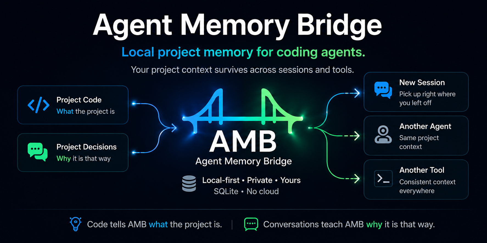
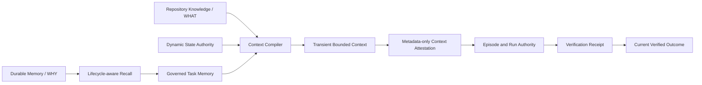

<p align="center">
  
</p>

<h1 align="center">Agent Memory Bridge</h1>

<p align="center"><strong>Teach one decision and its reason. The next session can recall that reason when it recalls at the start.</strong></p>

<p align="center">
  AMB keeps a confirmed project decision in a local store. A later session gets it back by recalling, not by rereading the old chat.
</p>

<p align="center"><a href="README.zh-CN.md">简体中文</a></p>

<p align="center">
  <a href="https://pypi.org/project/agent-memory-bridge/"></a>
  <a href="https://modelcontextprotocol.io"></a>
  <a href="https://github.com/zzhang82/Agent-Memory-Bridge/actions/workflows/ci.yml"></a>
  <a href="https://github.com/zzhang82/Agent-Memory-Bridge/releases"></a>
  <a href="LICENSE"></a>
  <a href="pyproject.toml"></a>
</p>

## The loop

One process stores a decision. A second process, on the same AMB home, recalls the claim and the reason. The recording is that local stdio proof. It is not a filmed coding-agent session, and it is not an adoption measurement.

The source is [examples/demo/first-win-demo.cast](examples/demo/first-win-demo.cast). The block below is an abridged transcript of that cast. Regenerating it runs the two processes, then writes generated playback: the header time and the line delays are fixed, not a measurement of the run. Command: `python ./scripts/build_first_win_cast.py`. Rendering a GIF needs `agg`; this repository does not include that GIF.

```text
# Session A: store one explicit decision
namespace: project:checkout-app
claim: Merge pull requests only after CI is green on the target branch.
reason: Broken main blocked two releases this month.
stored: true

# Session B: a second stdio process, same home, recall at start
query: What is required before we merge a pull request?
claim: Merge pull requests only after CI is green on the target branch.
reason: Broken main blocked two releases this month.
same_record: true
fresh_process: true
```

## Recall at the start

Connecting the server is not enough. The next session has to recall on purpose. This page does not claim that connecting MCP, or leaving a skill where it can be found, makes that happen by itself. There is no automatic learning.

Put this rule where the next session will actually follow it:

```text
Before changing code, recall this project's Agent Memory Bridge decisions and their reasons.
Use the namespace from `project resolve`. Call the public `recall` tool.
Store a decision only after it is confirmed. Do not treat chat history as already stored.
```

## Install, then bind the project

AMB requires **Python 3.11+** and Git.

Current package/source version: `0.38.0`.

```bash
python -m venv .amb-venv
<venv-python> -m pip install agent-memory-bridge==0.38.0
<venv-python> -m agent_mem_bridge project init .
```

Replace `<venv-python>` with the Python executable inside `.amb-venv`. `project init` detects the Git repository, proposes a namespace such as `project:my-app`, and waits for confirmation. It does not learn decisions from the tree. After that, `project resolve .` returns the namespace.

Run `<venv-python> -m agent_mem_bridge` with one persistent `AGENT_MEMORY_BRIDGE_HOME`. How a client launches that process stays outside Core. The command shape is in [Integrations](docs/INTEGRATIONS.md). Connection is real when the client lists `store` and `recall`.

Store one confirmed decision with `store`. In the next session, use the startup rule above and ask for that decision.

<details>
<summary>Clients, an existing home, and optional review</summary>

AMB does not discover, write, or certify Codex, Claude, Cursor, OpenCode, Hermes, Cline, VS Code, or Antigravity. Clients configure AMB as a standard MCP stdio server and point shared projects at the same local home.

If an existing bridge lives at `~/.codex/mem-bridge`, v0.36 does not open it automatically. Set `AGENT_MEMORY_BRIDGE_HOME` to that directory, or copy it to `~/.local/share/agent-memory-bridge`. The [configuration guide](docs/CONFIGURATION.md) has the cutover.

The companion skills are optional help for discovery and everyday use. They do not replace the startup rule above. Install them from [Agent-Memory-Skills](https://github.com/zzhang82/Agent-Memory-Skills):

```bash
npx skills add zzhang82/Agent-Memory-Skills --skill amb
npx skills add zzhang82/Agent-Memory-Skills --skill amb-connect
```

- [`amb`](https://github.com/zzhang82/Agent-Memory-Skills/blob/main/skills/amb/SKILL.md) ([raw](https://raw.githubusercontent.com/zzhang82/Agent-Memory-Skills/main/skills/amb/SKILL.md))
- [`amb-connect`](https://github.com/zzhang82/Agent-Memory-Skills/blob/main/skills/amb-connect/SKILL.md) ([raw](https://raw.githubusercontent.com/zzhang82/Agent-Memory-Skills/main/skills/amb-connect/SKILL.md))

For a source checkout, install with `<venv-python> -m pip install -e .` instead of the pinned package.

Human-first Explore answers “What does AMB currently know?” Inspect answers “Why did this information surface?” Both are local and read-only. They are not the success check.

```bash
<venv-python> -m agent_mem_bridge explore --namespace project:my-app
<venv-python> -m agent_mem_bridge inspect \
  --namespace project:my-app \
  --query "What is required before we merge a pull request?"
```

Code tells AMB what the repository contains. A confirmed decision tells it why. Derived repository facts come from a clean Git commit. If HEAD moves or the worktree is dirty, refresh on purpose:

```bash
<venv-python> -m agent_mem_bridge bootstrap-repo . --namespace project:my-app
```

Refreshing repository facts leaves stored decisions unchanged. Explore is CLI-only. It is not an extra MCP tool.

`doctor` and `verify` check server prerequisites. They do not prove that a client loaded its MCP config. `first-run` is optional guided help, not the first-win path. Historical Codex observations from the v0.35 line are in [First-win acceptance](docs/FIRST-WIN-ACCEPTANCE.md).

</details>

## Why the memory stays trustworthy

The useful part is not remembering more. It is knowing where a decision came from, whether it is still current, and how it changed.

| Memory concern | AMB approach |
|---|---|
| Current repository truth | Derived from a clean repository state and refreshed explicitly |
| Human decisions and constraints | Stored explicitly as governed durable memory |
| Changed knowledge | Revised or superseded instead of silently overwritten |
| Why context surfaced | Inspectable through local derived views and evidence paths |
| Cross-session reuse | Shared through the same configured local AMB home |
| Privacy | Local-first; no hosted memory service is required |

Code tells the next session what exists. AMB retains the confirmed reasons the code does not explain.

## What AMB is — and is not

AMB is a governed local project-memory layer for coding agents. Durable knowledge, derived repository facts, provenance, and corrections stay distinguishable.

It is not a transcript archive, a promise that an agent will remember everything, or a system that silently converts every conversation into durable truth. There is no automatic learning.

### Memory hygiene: Structure over prose

Do not treat memory as a prompt trash can for linter errors, directory conventions, or syntax dos and don'ts. If an agent makes the same mechanical mistake twice, harden the repository environment with linter rules, type guards, or pre-commit checks. Reserve AMB durable memory for the *reasons* that code cannot convey: architectural decisions, domain invariants, and third-party library gotchas. See the [Memory Hygiene Guide](docs/MEMORY-HYGIENE.md) for the 3-question ingestion filter.

## Want the details?

| Read | For |
|---|---|
| [First-win demo](examples/demo/README.md) | The local two-process recording, and the older coordination demo |
| [First-win acceptance](docs/FIRST-WIN-ACCEPTANCE.md) | Historical Codex observation from the v0.35 line |
| [Architecture](docs/ARCHITECTURE.md) | System shape and data flow |
| [Authority model](docs/AUTHORITY-CONTRACT.md) | Durable authority, derived views, correction, and audit rules |
| [Knowledge Explorer](docs/KNOWLEDGE-EXPLORER.md) | Human-first read-only project view |
| [Memory Hygiene](docs/MEMORY-HYGIENE.md) | Anti-pollution rules and the structure-over-prose boundary |
| [Production Status](docs/PRODUCTION-STATUS.md) | Current implementation facts, evidence, and known limits |
| [Integrations](docs/INTEGRATIONS.md) | Generic stdio MCP installer contract |
| [Install for Agents](INSTALL_FOR_AGENTS.md) | Full install-to-first-success workflow |
| [Configuration](docs/CONFIGURATION.md) | Complete configuration reference |
| [Examples](examples/README.md) | Sanitized demos and artifacts |

## Technical model

Internally, AMB keeps `derived_repository` data separate from governed durable memory so one cannot silently become the other. For maintainers and reviewers, the current authority flow is:



SQLite/WAL rows are durable authority. Repository snapshots, FTS rows, embedding sidecars, compiled context, reports, and Explorer views are derived. Context bodies are rendered in process and are not durably persisted by the compiler.

## Enterprise Gateway & Deployment

AMB runs as a local-first stdio process by default, with an optional official **Streamable HTTP transport** and **Enterprise Gateway**:

- **Local stdio**: 100% unauthenticated, zero-overhead execution for individual agents.
- **Enterprise Gateway**: Multi-token Bearer authentication, 4-role RBAC (`admin`, `writer`, `reader`, `orchestrator`), namespace tenant enclaves (`project:*`, `domain:*`), and zero-lock structured JSONL audit streaming.
- **Zero WAL Contention**: Audit events stream directly to stdout or dedicated files, preserving SQLite read latency (<5ms) under concurrent agent traffic.

For remote server, NAS, or container setup, see [Remote Deployment](docs/REMOTE-DEPLOYMENT.md).

## Trust and privacy

AMB is local-first. It does not require a hosted memory service. It separates durable memory from coordination Signals and mutable Dynamic State, keeps provenance visible, and rejects raw transcripts, hidden reasoning, and inline artifact bodies from the durable episode path.

Read the [Trust Boundary](docs/TRUST-BOUNDARY.md), [Authority Contract](docs/AUTHORITY-CONTRACT.md), and [Closed-Loop Episode Authority](docs/CLOSED-LOOP-EPISODE.md) for the exact boundaries.

## MCP Tools

AMB exposes **17 public MCP tools**:

- `store`, `recall`, `browse`, and `stats`
- `forget`, `feedback`, `promote`, `annotate`, `revise`, and `export`
- `begin_run`, `record_run_event`, `get_run`, and `complete_run`
- `claim_signal`, `extend_signal_lease`, and `ack_signal`

The public tool surface stays small. Setup, Project Init, Explore, Inspect, context assembly, and review reports remain CLI or internal derived workflows rather than becoming more MCP tools.

The local protocol cache contract is `300000/public` for discovery and `0/private` for the tool list; see [MCP Compatibility](docs/MCP-2026-COMPATIBILITY.md) for details.

## Current maturity

Current package/source version is `0.38.0`. Schema remains v12 and the public MCP surface remains exactly 17 tools. There is no automatic learning and no MCP tool #18. `project init` is the preferred first-project path. Default Explore is a Human-first view over existing repository-derived context and governed project knowledge. Current evidence and non-claims live in [Production Status](docs/PRODUCTION-STATUS.md); published artifacts live in [GitHub Releases](https://github.com/zzhang82/Agent-Memory-Bridge/releases).

## Contributing

Read [CONTRIBUTING.md](CONTRIBUTING.md) for development and public-surface expectations, and [SECURITY.md](SECURITY.md) for vulnerability reporting.

Licensed under [MIT](LICENSE).
