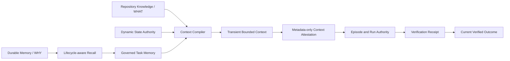

<p align="center">
  
</p>

<h1 align="center">Agent Memory Bridge</h1>

<p align="center"><strong>教一次决策和它的理由。下一次会话在开始时召回，就能带回那条理由。</strong></p>

<p align="center">
  AMB 把已确认的项目决策放在本地存储里。后来的会话要靠召回拿回它，而不是靠重读旧聊天。
</p>

<p align="center"><a href="README.md">English</a></p>

<p align="center">
  <a href="https://pypi.org/project/agent-memory-bridge/"></a>
  <a href="https://modelcontextprotocol.io"></a>
  <a href="https://github.com/zzhang82/Agent-Memory-Bridge/actions/workflows/ci.yml"></a>
  <a href="https://github.com/zzhang82/Agent-Memory-Bridge/releases"></a>
  <a href="LICENSE"></a>
  <a href="pyproject.toml"></a>
</p>

## 这一次闭环

一个进程存下一条决策。同一个 AMB home 上的第二个进程召回主张和理由。这段记录是本地 stdio 证明。它不是编码智能体的屏幕录像，也不是采用率测量。

来源是 [examples/demo/first-win-demo.cast](examples/demo/first-win-demo.cast)。下面的文本块是这段 cast 的节选。重新生成会先跑两个进程，再写入生成的回放：文件头时间和逐行延迟是固定的，不是这次运行的耗时测量。命令是 `python ./scripts/build_first_win_cast.py`。渲染 GIF 需要 `agg`；本仓库不附带该 GIF。

```text
# Session A: store one explicit decision
namespace: project:checkout-app
claim: Merge pull requests only after CI is green on the target branch.
reason: Broken main blocked two releases this month.
stored: true

# Session B: a second stdio process, same home, recall at start
query: What is required before we merge a pull request?
claim: Merge pull requests only after CI is green on the target branch.
reason: Broken main blocked two releases this month.
same_record: true
fresh_process: true
```

## 在会话开始时召回

只连上服务器不够。下一次会话必须主动召回。本页不声称连上 MCP，或把技能放在可发现的位置，就会自己完成这一步。没有自动学习。

把下面这条规则放在下一次会话真正会遵守的地方：

```text
改代码之前，先召回这个项目在 Agent Memory Bridge 里的决策和理由。
使用 `project resolve` 得到的 namespace。调用公开的 `recall` 工具。
只在决策被确认之后再 store。不要把聊天记录当成已经保存的记忆。
```

## 安装，然后绑定项目

AMB 需要 **Python 3.11+** 和 Git。

当前包/源码版本：`0.38.2`。

```bash
python -m venv .amb-venv
<venv-python> -m pip install agent-memory-bridge==0.38.2
<venv-python> -m agent_mem_bridge project init .
```

用 `.amb-venv` 里的 Python 可执行文件代替 `<venv-python>`。`project init` 检测 Git 仓库，建议一个类似 `project:my-app` 的 namespace，并等待确认。它不会从代码树学习决策。绑定之后，`project resolve .` 返回该 namespace。

用持久的 `AGENT_MEMORY_BRIDGE_HOME` 运行 `<venv-python> -m agent_mem_bridge`。客户端如何启动这个进程不属于 Core。命令形式见[集成文档](docs/INTEGRATIONS.md)。客户端列出 `store` 和 `recall` 时，连接才算成立。

用 `store` 保存一条已确认的决策。下一次会话按上面的启动规则询问这条决策。

<details>
<summary>客户端、已有 home，以及可选审阅</summary>

AMB 不会发现、写入或认证 Codex、Claude、Cursor、OpenCode、Hermes、Cline、VS Code 或 Antigravity。客户端把 AMB 配置为标准 MCP stdio 服务，并让共享同一项目的客户端指向同一个本地 home。

如果已有 bridge 位于 `~/.codex/mem-bridge`，v0.36 不会自动打开它。把 `AGENT_MEMORY_BRIDGE_HOME` 指到该目录，或把目录复制到 `~/.local/share/agent-memory-bridge`。具体切换见[配置说明](docs/CONFIGURATION.md)。

配套技能是发现和日常使用的可选帮助。它们不能代替上面的启动规则。从 [Agent-Memory-Skills](https://github.com/zzhang82/Agent-Memory-Skills) 安装：

```bash
npx skills add zzhang82/Agent-Memory-Skills --skill amb
npx skills add zzhang82/Agent-Memory-Skills --skill amb-connect
```

- [`amb`](https://github.com/zzhang82/Agent-Memory-Skills/blob/main/skills/amb/SKILL.md)（[raw](https://raw.githubusercontent.com/zzhang82/Agent-Memory-Skills/main/skills/amb/SKILL.md)）
- [`amb-connect`](https://github.com/zzhang82/Agent-Memory-Skills/blob/main/skills/amb-connect/SKILL.md)（[raw](https://raw.githubusercontent.com/zzhang82/Agent-Memory-Skills/main/skills/amb-connect/SKILL.md)）

源码检出请改用 `<venv-python> -m pip install -e .`，不要装固定版本包。

面向人的 Explore 回答“AMB 现在知道什么”。Inspect 回答“这条信息为什么出现”。两者都是本地只读操作，不是成功验收。

```bash
<venv-python> -m agent_mem_bridge explore --namespace project:my-app
<venv-python> -m agent_mem_bridge inspect \
  --namespace project:my-app \
  --query "What is required before we merge a pull request?"
```

代码告诉 AMB 仓库里有什么。已确认的决策告诉它为什么。派生的仓库事实来自一次干净的 Git 提交。HEAD 变了，或工作区不干净时，要显式刷新：

```bash
<venv-python> -m agent_mem_bridge bootstrap-repo . --namespace project:my-app
```

刷新仓库事实不会改动已保存的决策。Explore 只在 CLI 里，不是多出来的 MCP 工具。

`doctor` 和 `verify` 检查服务端先决条件。它们不能证明客户端加载了 MCP 配置。`first-run` 是可选引导，不是第一次成功的路径。v0.35 系列的历史 Codex 观察记录见[首次成功验收](docs/FIRST-WIN-ACCEPTANCE.md)。

</details>

## 为什么这份记忆能保持可信

有用的部分不是记得更多，而是知道一条决策从哪里来、现在是否仍然有效，以及后来怎样变过。

| 记忆问题 | AMB 的处理方式 |
|---|---|
| 当前仓库事实 | 从干净仓库状态派生，并显式刷新 |
| 人做出的决策和约束 | 作为受治理的持久记忆显式保存 |
| 已经变化的知识 | 通过修订或 supersession 演化，而不是静默覆盖 |
| 某段上下文为什么出现 | 可通过本地派生视图与 evidence path 检查 |
| 跨会话复用 | 通过同一个已配置的本地 AMB home 共享 |
| 隐私 | 本地优先，不要求托管式记忆服务 |

代码告诉下一次会话现在有什么。AMB 保留代码解释不了的、已经确认的理由。

## AMB 是什么——以及不是什么

AMB 是面向编码智能体的、受治理的本地项目记忆层。持久知识、仓库派生事实、provenance 和后续修正保持可区分。

它不是聊天记录归档器，不承诺智能体会记住所有事情，也不会默默把每一段对话都转换成持久事实。它没有自动学习。

### 记忆卫生：结构优先于提示词

切勿将记忆当成存放 linter 报错、目录约定或语法禁忌的“提示词垃圾桶”。如果智能体两次犯同样的机械性错误，请通过 linter 规则、类型守卫（type guard）或 pre-commit 检查来加固仓库环境。AMB 持久记忆应严格保留给代码无法自述的“原因”：架构决策、业务不变量边界与第三方库坑点。详见[记忆卫生指南](docs/MEMORY-HYGIENE.md)与 3 步入库过滤法则。

## 想了解细节？

| 文档 | 用途 |
|---|---|
| [首次成功演示](examples/demo/README.md) | 本地双进程记录，以及更早的协作演示 |
| [首次成功验收](docs/FIRST-WIN-ACCEPTANCE.md) | v0.35 系列的历史 Codex 观察记录 |
| [架构](docs/ARCHITECTURE.md) | 系统形态与数据流 |
| [权威模型](docs/AUTHORITY-CONTRACT.md) | 持久权威、派生视图、修正与审计规则 |
| [Knowledge Explorer](docs/KNOWLEDGE-EXPLORER.md) | 面向人的只读项目视图 |
| [记忆卫生指南](docs/MEMORY-HYGIENE.md) | 防污染准则与“结构优于提示词”边界 |
| [生产状态](docs/PRODUCTION-STATUS.md) | 当前实现事实、证据与已知边界 |
| [集成](docs/INTEGRATIONS.md) | 通用 stdio MCP 安装契约 |
| [智能体安装指南](INSTALL_FOR_AGENTS.md) | 从安装到首次成功的完整流程 |
| [配置](docs/CONFIGURATION.md) | 完整配置参考 |
| [示例](examples/README.md) | 脱敏 Demo 与工件 |

## 技术模型

在内部，AMB 将 `derived_repository` 数据与受治理的持久记忆分开，避免一方悄悄变成另一方。对维护者和审阅者，当前权威流如下：



SQLite/WAL 记录是持久权威。仓库 snapshot、FTS 记录、embedding sidecar、编译上下文、报告和 Explorer 视图都是派生内容。Context Compiler 只在进程内渲染上下文正文，不会将其持久保存。

## 可选 HTTP 网关与部署

AMB 默认作为本地优先的 stdio 进程运行，同时提供官方可选的 **Streamable HTTP 传输**与**可选 HTTP 网关**：

- **本地 stdio**：无需认证或网关配置；对单个 Agent 的运行方式与此前相同。
- **可选 HTTP 网关**：按客户端使用 Bearer token、4 种角色（`admin`、`writer`、`reader`、`orchestrator`）、命名空间限制（`project:*`、`domain:*`），以及结构化 JSONL 审计行。
- **审计不进入 SQLite**：审计行写入 stdout、stderr 或文件，不写入数据库。

远程服务器、NAS 或容器化部署详情请参阅[远程部署指南](docs/REMOTE-DEPLOYMENT.md)。

## 信任与隐私

AMB 本地优先，不依赖托管式记忆服务。它将持久记忆、协作 Signal 和可变 Dynamic State 分开，保留可见 provenance，并拒绝把原始 transcript、隐藏推理或内联 artifact body 写入持久 episode 通道。

精确边界请见[信任边界](docs/TRUST-BOUNDARY.md)、[权威契约](docs/AUTHORITY-CONTRACT.md)和[闭环 Episode 权威](docs/CLOSED-LOOP-EPISODE.md)。

## MCP 工具

AMB 暴露 **17 个公开 MCP 工具**：

- `store`、`recall`、`browse`、`stats`
- `forget`、`feedback`、`promote`、`annotate`、`revise`、`export`
- `begin_run`、`record_run_event`、`get_run`、`complete_run`
- `claim_signal`、`extend_signal_lease`、`ack_signal`

公开工具接口保持精简。Setup、Project Init、Explore、Inspect、上下文组装和审阅报告继续作为 CLI 或内部派生工作流，而不会变成更多 MCP 工具。

本地协议缓存契约为：discovery 使用 `300000/public`，工具列表使用 `0/private`。详情请见 [MCP 兼容性](docs/MCP-2026-COMPATIBILITY.md)。

## 当前成熟度

当前包/源码版本是 `0.38.2`。schema 仍为 v12，公开 MCP 接口仍是恰好 17 个工具。没有自动学习，也没有 MCP 工具 #18。`project init` 是首选的首次项目路径。默认 Explore 是覆盖现有仓库派生上下文与受治理项目知识的 Human-first 视图。当前证据与非声明位于[生产状态](docs/PRODUCTION-STATUS.md)，已发布工件位于 [GitHub Releases](https://github.com/zzhang82/Agent-Memory-Bridge/releases)。

## 参与贡献

开发和公开接口要求请见 [CONTRIBUTING.md](CONTRIBUTING.md)，漏洞报告方式请见 [SECURITY.md](SECURITY.md)。

项目采用 [MIT](LICENSE) 许可证。
